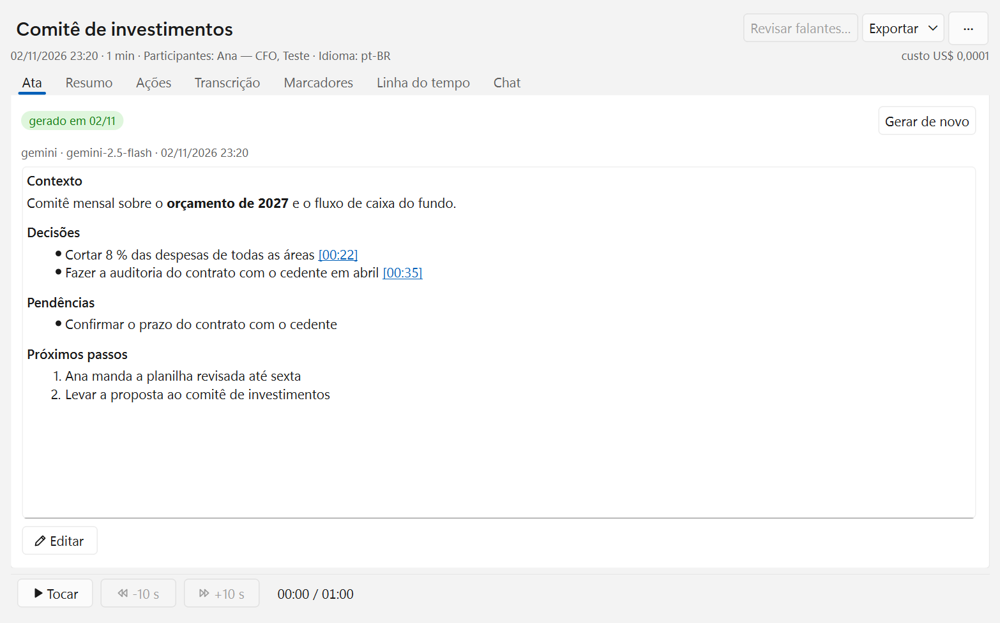

# listener-meet

Gravador de reuniões para Windows, de código aberto (MIT). Grava Teams, Meet, Zoom ou qualquer app, sem bot na
chamada e sem ligar nada na plataforma. Identifica quem fala por perfil de voz, transcreve na sua máquina e gera a ata
com a LLM que você escolher (Gemini ou Claude). Tudo fica num banco SQLite no seu computador.



## O que ele faz
- **Dois canais.** O seu microfone e o áudio do app da reunião são gravados separados. Se você entra numa chamada e
  esquece de gravar, o app avisa.
- **Quem falou.** A diarização é do pyannote, e cada pessoa ganha um perfil de voz que melhora a cada confirmação: você
  confirma uma vez e, nas próximas reuniões, ele reconhece a voz.
- **Transcrição local.** Whisper (faster-whisper) só com CPU, sem placa de vídeo, e legenda ao vivo durante a chamada.
- **Ata com evidência.** Decisões, ações (com dono e prazo) e destaques. Cada item aponta o trecho e o minuto da fala
  que o sustenta, e o item sem citação válida fica marcado como sem evidência.
- **Perguntar às reuniões.** Perguntas sobre todas as reuniões, respondidas com links para a reunião e o minuto. A
  busca é por palavra e por sentido (a busca local, depois de baixada, não custa nada nem precisa de rede).
- **LLM que você escolhe.** Gemini, Claude ou GPT: trocar é configuração. Os prompts, os esquemas da ata e a validação
  das respostas são do projeto, não do provedor.

## Apoie o listener-meet
O listener-meet é gratuito, de código aberto e feito por uma pessoa só. Se ele te poupa tempo, um gesto simbólico ajuda
a manter tudo funcionando e a trazer novidades:

- **Pix:** R$ 0,99, ou o valor que você quiser, para a chave `herculanocm@outlook.com`.
- **PayPal:** US$ 0,20 para `herculanocm@outlook.com`, pelo "Enviar dinheiro" do PayPal.

O app traz o mesmo convite em "Apoiar o listener-meet", no Sobre e no rodapé do Histórico. Uma estrela no repositório e
indicar o projeto a quem vive em reunião também ajudam. Obrigado de verdade!

## Seus dados
- Áudio, transcrições, perfis de voz e configurações ficam no SQLite do app, numa pasta que você escolhe. O áudio fica
  em FLAC, num arquivo por mês.
- Por padrão, só o texto da reunião vai para a LLM escolhida; o áudio só sai se você ligar a opção.
- Nada é apagado sozinho: só você apaga.
- As chaves de API ficam no banco, em texto aberto: mantenha a pasta do banco fora do OneDrive e do git.
- Grave só com o consentimento de quem participa da reunião.

## O que você precisa
- Windows 11, onde o app é desenvolvido e testado. Linux e macOS estão no plano (F7).
- Python 3.12 e uma CPU comum; a legenda ao vivo liga sozinha com 8 núcleos ou mais.
- O token gratuito do Hugging Face, para o pyannote identificar quem fala, e a chave da LLM, para a ata. O assistente
  da primeira abertura mostra onde conseguir os dois.

## Rodar (Windows)

```powershell
# venv Python 3.12 no checkout, com a stack travada do Windows (versões provadas nesta máquina; D-050)
py -3.12 -m venv .venv
.venv\Scripts\python.exe -m pip install -r requirements\windows.txt
.venv\Scripts\python.exe -m pip install -e . --no-deps
.venv\Scripts\python.exe -m listener
```

Sem a stack de ML (só captura, fila e LLM): `pip install -e .[dev,win32,llm]`; a busca local e o .docx (F5.1) pedem
também `[local,docx]` (o lock já traz os dois), e a busca local se baixa em Configurações › Busca (135 MB). Para
atualizar o lock, o comando está no cabeçalho de `requirements/windows.txt` (ele usa o próprio lock como restrição:
versão nova só entra de propósito).

Na primeira vez abre o assistente (seus dados, pasta do banco, chaves e teste do microfone). Depois: ícone na bandeja,
`Ctrl+Alt+Shift+R` abre o "Antes de gravar" e `Ctrl+Alt+Shift+H` o Histórico (busca, ações abertas e perguntas sobre
todas as reuniões; a reunião aberta tem a linha do tempo por falante e salva .docx). Gravar mostra o widget flutuante
(pausar, marcador com nota, mudo global, parar, cancelar). O log fica no arquivo escolhido na primeira abertura, com o
nível editável nas Configurações. Para o desenvolvimento: `--selftest` (grava alguns segundos sem interface) e
`--check <pasta do banco>` (relatório de continuidade de cada gravação, do ao vivo e do índice da busca).

## Gerar o executável e o zip (Windows)
O executável sai numa pasta, sem console (PyInstaller `--onedir --windowed`), e não num arquivo único, que se
descompactaria a cada abertura e deixaria o app mais lento (D-069).

```powershell
# uma vez, e de novo sempre que o lock do app mudar: as ferramentas de build (o app nunca as importa)
.venv\Scripts\python.exe -m pip install -r requirements\build-windows.txt
# ~7 min, sem rede; com --zip, o build recusa se houver mudança sem commit
.venv\Scripts\python.exe scripts\build_exe.py --zip
```

- O app fica em `build\exe\dist\listener-meet\listener-meet.exe`. Sem o `--zip`, o build sai só com a pasta.
- Para compartilhar, use o `build\exe\listener-meet-<versão>-win64.zip`, com a pasta inteira (~350 MB): o `.exe`
  sozinho não roda.
- Feche o app antes: com ele ou um worker aberto, o build recusa e a pasta antiga fica intacta.
- A versão vem de `listener/__init__.py`, e o commit do build aparece no Sobre (D-081).

## Como contribuir
Este repositório segue **Spec-Driven Development**: nenhum código existe sem uma spec aprovada pelo dono. Comece por
uma issue com o problema ou a ideia; a mudança vira uma spec em `specs/features/` (o modelo está em `specs/README.md`)
e o código vem depois da aprovação.

- Pessoas e LLMs: comecem por [AGENTS.md](AGENTS.md) (a ordem de leitura e as cláusulas do projeto).
- O que o sistema é: [ARCHITECTURE.md](ARCHITECTURE.md).
- O que o dono quer: [specs/00-handoff-v4.md](specs/00-handoff-v4.md) (o documento mestre).
- O estado e o que fazer agora: [specs/backlog.md](specs/backlog.md).

Frentes abertas para quem quiser ajudar:
- **Linux e macOS** (F7): o que depende do sistema operacional fica em `listener/platform/<os>/`.
- **Tradução da interface**: hoje os textos são fixos em português.
- **Testes de verdade** em outras máquinas, microfones e apps de reunião; o passo a passo está em
  `specs/roteiro-teste-windows.md`.
- **Outros provedores** de LLM e de busca por sentido: a camada em `listener/llm/` é agnóstica.

Testes (qualquer sistema, com a plataforma simulada): `python -m pytest -q` roda a parte rápida e `python -m pytest -q
--tudo` a suíte inteira (antes de commitar, e no CI); lint e tipos: `ruff check .` e `mypy`. No Linux, a captura
precisa da `libportaudio2`.

## Licença
MIT ([LICENSE](LICENSE)).
